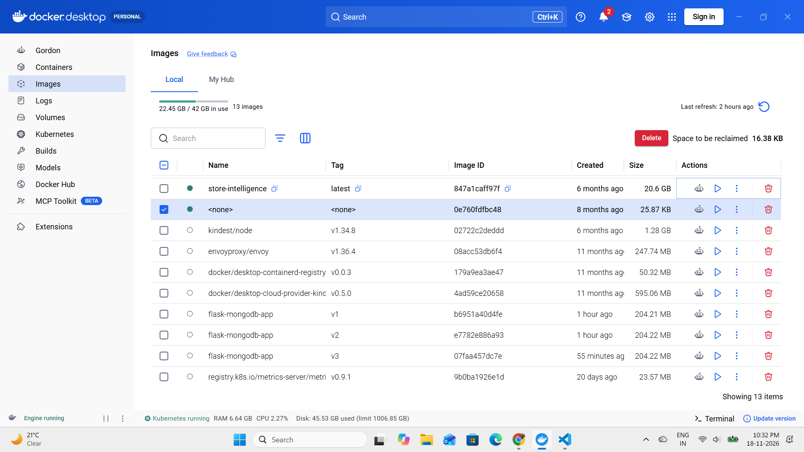
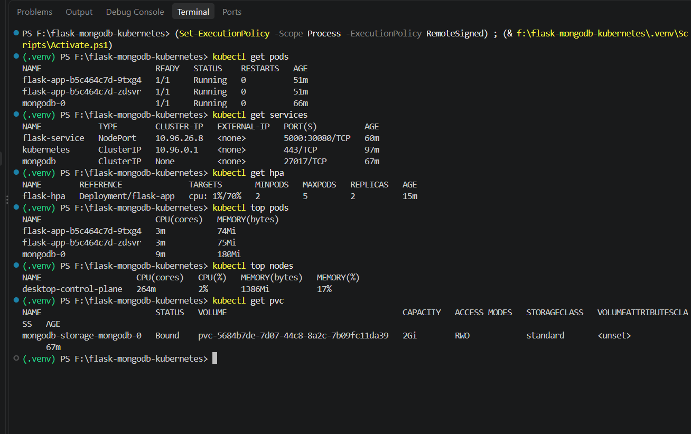
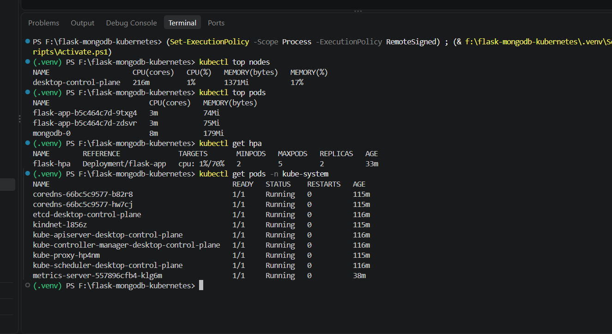
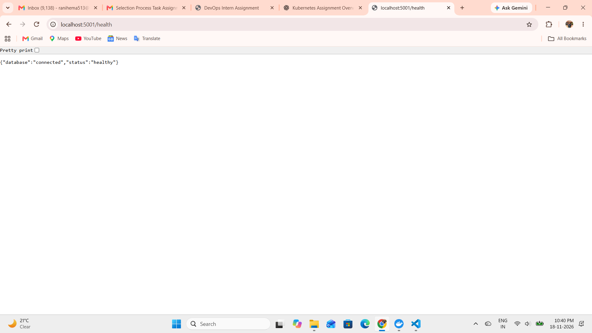
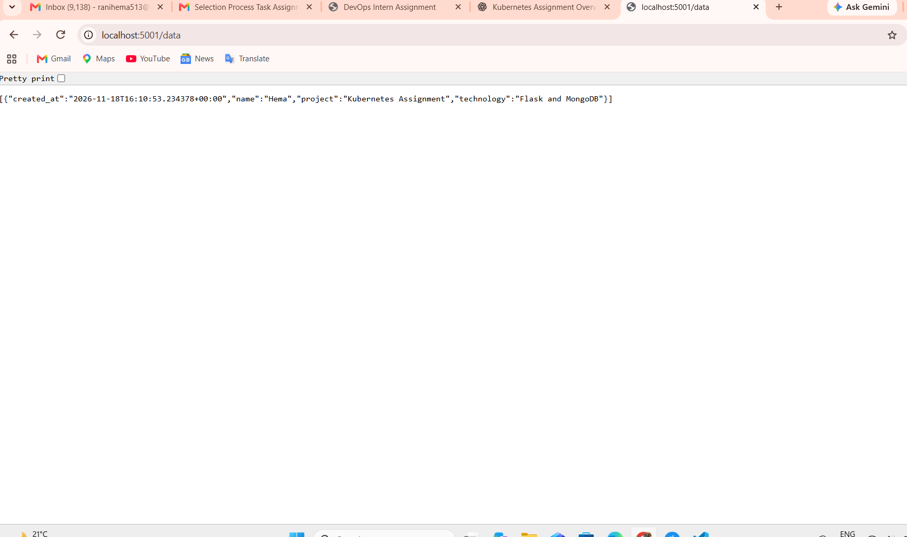
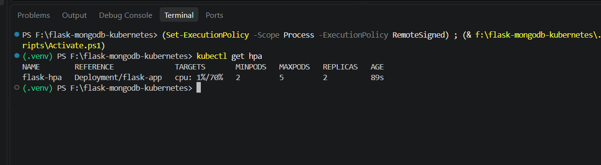
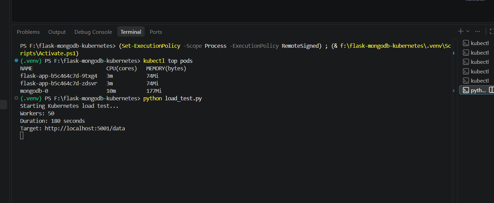
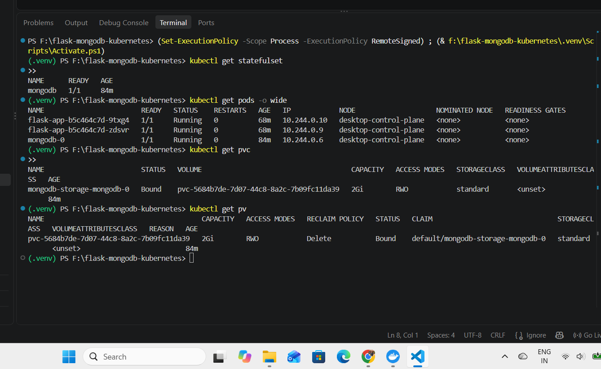

# Flask + MongoDB on Kubernetes

### Containerized Application with Horizontal Pod Autoscaling


A containerized Flask REST API integrated with MongoDB, deployed on a local Kubernetes cluster using Docker Desktop. This project demonstrates containerization, persistent storage, service discovery, health monitoring, resource management, horizontal pod autoscaling, and load testing.


**---**


## 1. Project Overview


This project demonstrates the deployment and management of a Flask-based backend application connected to MongoDB using Docker and Kubernetes.


The application supports:

- Flask REST API endpoints.

- MongoDB database integration.

- Containerization using Docker.

- Kubernetes Deployment and StatefulSet.

- Persistent Volume Claims for MongoDB storage.

- Kubernetes Services for internal communication.

- Health monitoring and readiness/liveness probes.

- Horizontal Pod Autoscaling (HPA).

- Metrics Server integration.

- Concurrent load testing.


## 2. Technology Stack


| Technology | Purpose |

|---|---|

| Python 3.13 | Backend development |

| Flask 3.1.1 | REST API framework |

| MongoDB 7 | Database |

| PyMongo 4.10.1 | MongoDB integration |

| Docker | Containerization |

| Docker Desktop | Local container runtime |

| Kubernetes | Container orchestration |

| kubectl | Kubernetes management |

| Metrics Server | Resource monitoring |

| HPA | Automatic pod scaling |

| Gunicorn | Production WSGI server |

| PowerShell | Windows command-line environment |


## 3. System Architecture


```text

             Client / API Request

                     |

                     v

             Flask Kubernetes

                  Service

                     |

          +----------+----------+

          |          |          |

          v          v          v

       Flask      Flask      Flask

        Pod        Pod        Pod

          |          |          |

          +----------+----------+

                     |

                     v

              MongoDB Service

                     |

                     v

               MongoDB Pod

                     |

                     v

             Persistent Volume


        Kubernetes Metrics Server

                     |

                     v

              Horizontal Pod

               Autoscaler

                     |

                     v

           Dynamic Flask Replicas

```


## 4. Project Structure


```text

flask-mongodb-kubernetes/

│

├── app/

│   ├── app.py

│   └── requirements.txt

│

├── k8s/

│   ├── flask-deployment.yaml

│   ├── flask-service.yaml

│   ├── mongodb-secret.yaml

│   ├── mongodb-service.yaml

│   ├── mongodb-statefulset.yaml

│   └── flask-hpa.yaml

│

├── screenshots/

│   ├── 01-docker-images.png

│   ├── 02-kubernetes-pods.png

│   ├── 03-mongodb-running.png

│   ├── 04-flask-api-health.png

│   ├── 05-data-insertion.png

│   ├── 06-hpa-autoscaling.png

│   ├── 07-load-test.png

│   └── 08-resource-usage.png

│

├── Dockerfile

├── .dockerignore

├── .gitignore

├── load_test.py

└── README.md

```


## 5. Prerequisites


Install the following tools:


- Docker Desktop

- Python 3.13+

- Visual Studio Code

- kubectl

- Kubernetes enabled in Docker Desktop


Verify installations:


```powershell

python --version

docker --version

kubectl version --client

```


Check Kubernetes cluster:


```powershell

kubectl get nodes

```


## 6. Application Setup


Clone the repository:


```bash

git clone <YOUR_GITHUB_REPOSITORY_URL>

cd flask-mongodb-kubernetes

```


Create and activate a virtual environment:


```powershell

python -m venv .venv


.\\.venv\Scripts\Activate.ps1

```


Install dependencies:


```powershell

pip install -r app/requirements.txt

```


## 7. Docker Image Build


Build the Flask application image:


```powershell

docker build -t flask-mongodb-app:v3 .

```


Verify the image:


```powershell

docker images

```


The image is built locally and used by the Kubernetes Flask Deployment.

### Push the image to Docker Hub

To make the image available to another Kubernetes cluster, tag it with your Docker Hub username and push it to the registry:

```powershell
docker login
docker tag flask-mongodb-app:v3 YOUR_DOCKERHUB_USERNAME/flask-mongodb-app:v3
docker push YOUR_DOCKERHUB_USERNAME/flask-mongodb-app:v3
```

Replace `YOUR_DOCKERHUB_USERNAME` with your Docker Hub username. For deployments outside the local Docker Desktop cluster, update the `image` field in `k8s/flask-deployment.yaml` to:

```yaml
image: YOUR_DOCKERHUB_USERNAME/flask-mongodb-app:v3
```

Do not commit registry credentials or access tokens.

> **Security note:** Do not publish real database passwords, tokens, or credentials. Keep `k8s/mongodb-secret.yaml` out of a public repository if it contains a real password. Provide a sanitized example manifest with placeholder values instead, and create the actual Secret locally.

## 8. Kubernetes Deployment


### Step 1: Configure MongoDB credentials


```powershell

kubectl apply -f k8s/mongodb-secret.yaml

```


### Step 2: Deploy MongoDB Service


```powershell

kubectl apply -f k8s/mongodb-service.yaml

```


### Step 3: Deploy MongoDB StatefulSet


```powershell

kubectl apply -f k8s/mongodb-statefulset.yaml

```


### Step 4: Verify MongoDB


```powershell

kubectl get pods

kubectl get pvc

kubectl get services

```


### Step 5: Deploy Flask application


```powershell

kubectl apply -f k8s/flask-deployment.yaml

```


### Step 6: Create Flask Service


```powershell

kubectl apply -f k8s/flask-service.yaml

```


### Step 7: Verify deployment


```powershell

kubectl get deployments

kubectl get pods

kubectl get services

```


## 9. API Testing


Forward the Flask service to your local machine:


```powershell

kubectl port-forward service/flask-service 5001:5000

```


The API is available at:


`http://localhost:5001`


### Available endpoints


| Method | Endpoint | Description |

|---|---|---|

| GET | `/` | Application welcome endpoint |

| GET | `/health` | Application and database health check |

| POST | `/data` | Insert a document into MongoDB |

| GET | `/data` | Retrieve stored documents |


### Example POST request


```json

{

  "name": "Hema",

  "project": "Kubernetes Assignment",

  "technology": "Flask and MongoDB"

}

```


Example PowerShell request:


```powershell

$body = @{

    name = "Hema"

    project = "Kubernetes Assignment"

    technology = "Flask and MongoDB"

} | ConvertTo-Json


Invoke-RestMethod `

    -Uri http://localhost:5001/data `

    -Method POST `

    -ContentType "application/json" `

    -Body $body

```


Retrieve data:


```powershell

Invoke-RestMethod http://localhost:5001/data

```


## 10. DNS Resolution and Inter-Pod Communication

Kubernetes provides an internal DNS service that allows pods to discover Services by name rather than relying on changing pod IP addresses.

In this project, the Flask pods connect to MongoDB using the Service DNS name `mongodb` and port `27017`. The Flask Deployment receives these values through environment variables:

- `MONGO_HOST=mongodb`
- `MONGO_PORT=27017`

When Flask connects to `mongodb:27017`, Kubernetes DNS resolves `mongodb` to the MongoDB Service address. The MongoDB Service then routes the connection to the MongoDB pod selected by its Service endpoints.

The communication flow is:

1. A Flask pod sends a database request to `mongodb:27017`.
2. Cluster DNS resolves the `mongodb` Service name.
3. The MongoDB Service forwards traffic to the MongoDB pod on port `27017`.
4. MongoDB verifies the supplied username and password.
5. MongoDB processes the request and returns the result to Flask.

Using a Service DNS name avoids hardcoding pod IP addresses and allows MongoDB pods to be replaced without changing the Flask connection configuration.

## 11. Horizontal Pod Autoscaling


The application uses Kubernetes Horizontal Pod Autoscaling to adjust the number of Flask replicas based on CPU utilization.


Configuration:


| Parameter | Value |

|---|---|

| Minimum replicas | 2 |

| Maximum replicas | 5 |

| CPU utilization target | 70% |

| Scaling resource | Flask Deployment |


Apply HPA configuration:


```powershell

kubectl apply -f k8s/flask-hpa.yaml

```


Verify autoscaling:


```powershell

kubectl get hpa

```


Monitor autoscaling continuously:


```powershell

kubectl get hpa flask-hpa -w

```


Monitor pods:


```powershell

kubectl get pods -w

```


**\*\*Observed result:\*\*** During load testing, the Flask deployment scaled from its baseline of 2 replicas to 4 replicas. A later post-test observation showed 3 replicas.


## 12. Metrics Server and Resource Monitoring


Metrics Server was installed and configured in the Kubernetes cluster.


Check node utilization:


```powershell

kubectl top nodes

```


Check pod utilization:


```powershell

kubectl top pods

```


Check Metrics Server deployment:


```powershell

kubectl get deployment metrics-server -n kube-system

```


The Metrics Server provides CPU and memory metrics required by the Horizontal Pod Autoscaler.


## 13. Load Testing


A Python-based concurrent load-testing script was used to evaluate the application's performance.


### Test Configuration


| Parameter | Value |

|---|---:|

| Concurrent workers | 50 |

| Test duration | 180 seconds |

| Target endpoint | `/data` |

| Target URL | `http://localhost:5001/data` |


### Actual Test Results


| Metric | Observed Result |

|---|---:|

| Duration | 180.44 seconds |

| Successful requests | 24,177 |

| Failed requests | 6,460 |

| Total requests | 30,637 |

| Successful request rate | 78.91% |

| Successful requests per second | 133.99 |


### Performance Observations


- The application processed more than 24,000 successful requests.

- Kubernetes autoscaling was observed during the test.

- Flask replicas increased from 2 to 4.

- MongoDB remained operational during the observed test.

- Failed requests require further investigation to identify their underlying causes.


**\*\*Note:\*\*** The 133.99 requests/second figure represents successful requests per second, not total attempted request throughput.


## 14. Resource Requests and Limits

Kubernetes resource requests and limits help the scheduler place pods appropriately and prevent containers from consuming excessive node resources.

- **Requests** are the resources Kubernetes uses when scheduling a pod. They represent the amount the container is expected to need.
- **Limits** define the maximum resource consumption allowed for a container. CPU usage is throttled when its limit is reached; a container that exceeds its memory limit may be terminated with an out-of-memory (OOM) error.

The assignment's sample values are configured for both Flask and MongoDB containers:

| Resource | CPU | Memory |
|---|---:|---:|
| Request | `200m` (0.2 CPU) | `250Mi` |
| Limit | `500m` (0.5 CPU) | `500Mi` |

These values provide a baseline for scheduling and resource control. They should be tuned according to measured workload requirements.

## 15. Design Choices and Alternatives

**1. Docker Desktop Kubernetes**

Docker Desktop Kubernetes was selected because it provides a convenient local Kubernetes environment on Windows and integrates with the local Docker image store. Minikube was an alternative, but Docker Desktop was sufficient for this local assignment.

**2. MongoDB StatefulSet**

MongoDB is deployed as a StatefulSet because a database benefits from a stable pod identity and persistent storage. A Deployment is commonly used for stateless application replicas, such as the Flask API.

**3. MongoDB internal Service**

MongoDB uses an internal Service so Flask pods can reach it inside the cluster without exposing the database directly to the local machine or public network.

**4. Flask Deployment**

Flask uses a Deployment with at least two replicas. This supports replica management and allows Kubernetes to replace failed application pods.

**5. Horizontal Pod Autoscaler**

HPA scales the Flask Deployment based on CPU utilization, with a target of 70%, a minimum of 2 replicas, and a maximum of 5 replicas.

**6. Kubernetes Secret**

MongoDB credentials are supplied through a Kubernetes Secret rather than hardcoded in the Flask source code. For a production environment, use an appropriately managed secret solution and restrict access through RBAC.

**7. Persistent storage**

MongoDB data is stored on a persistent volume claimed by the StatefulSet. This allows data to survive MongoDB pod replacement. In this setup, the StatefulSet's `volumeClaimTemplates` requests storage through the cluster's storage provisioner; a PersistentVolume is dynamically provisioned when supported by the StorageClass.

## 16. Screenshots and Demonstrations


The following screenshots document the actual execution and deployment process.


### Docker Image





### Kubernetes Pods





### MongoDB Deployment





### Flask API Health Check





### MongoDB Data Insertion





### Horizontal Pod Autoscaling





### Load Testing Results





### Resource Monitoring





## 17. Key Learning Outcomes


Through this project, I gained practical experience in:


1\. Building and containerizing Python applications using Docker.

2\. Deploying multi-component applications using Kubernetes.

3\. Managing application configuration and database credentials.

4\. Configuring persistent storage for MongoDB.

5\. Implementing Kubernetes health monitoring.

6\. Configuring Horizontal Pod Autoscaling.

7\. Monitoring CPU and memory utilization.

8\. Performing concurrent load testing.

9\. Troubleshooting container and Kubernetes deployment issues.


## 18. Future Improvements


- Improve API response times under high concurrency.

- Investigate and reduce failed HTTP requests.

- Add structured logging and monitoring dashboards.

- Implement automated CI/CD pipelines.

- Add authentication and authorization.

- Introduce Prometheus and Grafana monitoring.

- Perform database performance optimization.


## 19. Author


**\*\*Hema Rani\*\***


B.Tech – Computer Science and Engineering (AI & ML)


Project: Flask + MongoDB on Kubernetes


**---**


**\*\*Thank you for reviewing this project!\*\***
